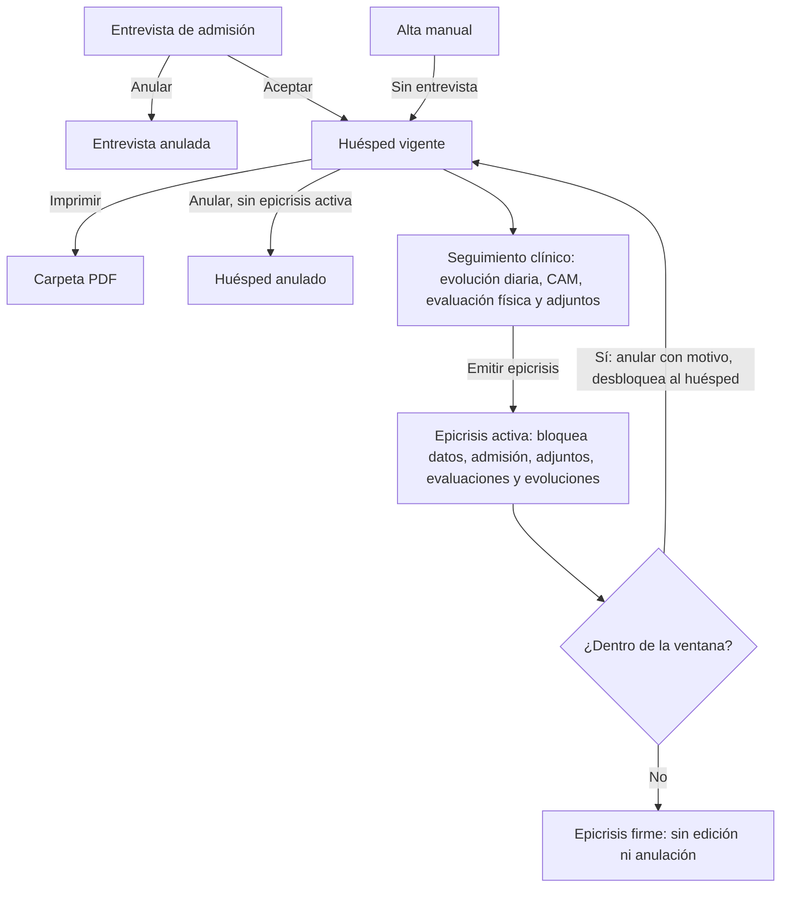
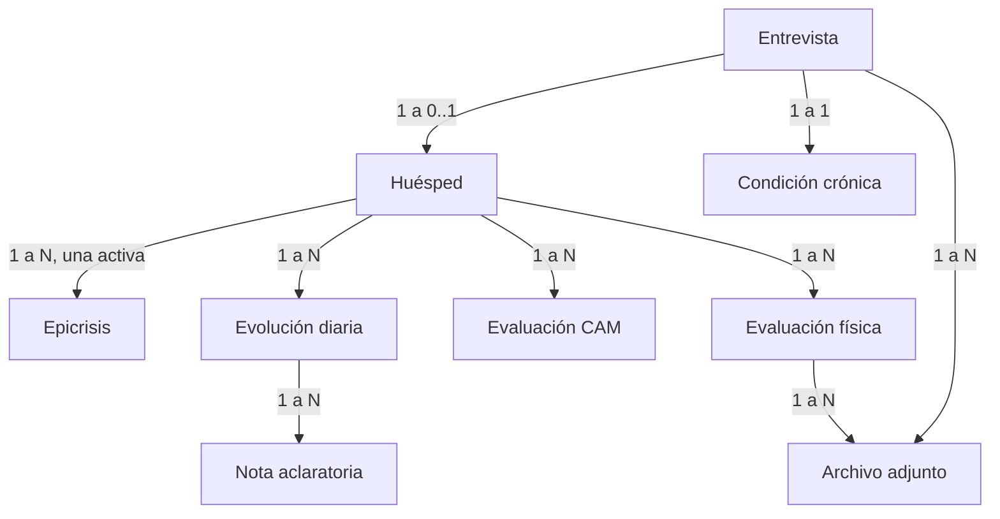
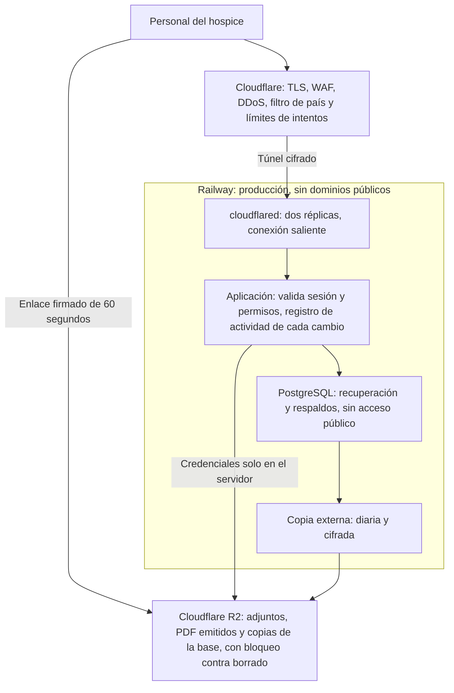

# ERS — Hospicare (Hospice Madre Teresa)

Nov 9, 2026 · @Matías Viaggio

## 1. Introducción

Esta ERS fija como línea base obligatoria todo lo que Hospicare hace hoy: cada requisito descripto aquí debe existir en la reconstrucción, porque esta versión sale a producción y sus datos y flujos pasan a ser operación real del hospice.

### 1.1 Propósito

Definir qué debe hacer el sistema, de forma independiente de cómo está programado. La reconstrucción puede cambiar arquitectura, código y pantallas, pero no puede perder comportamiento sin una decisión explícita registrada en la sección 14.

### 1.2 Alcance del producto

Hospicare es el sistema de operación clínica y administrativa del Hospice Madre Teresa (HMT). Cubre el ciclo completo de una persona atendida: entrevista de admisión, alta como huésped, seguimiento clínico, epicrisis de cierre e impresión de la carpeta completa. También cubre usuarios, roles, catálogos, configuración, registro de actividad, tablero de reportes y manual de uso.

Quedan fuera del producto actual: facturación a obras sociales, farmacia y stock, agenda de turnos, indicaciones médicas estructuradas, registro de voluntariado, portal para familias e interoperabilidad con sistemas externos de salud.

### 1.3 Audiencia

Dirigida a la dirección y equipo clínico del hospice (validación), a quienes reconstruyan el sistema (implementación) y a quienes lo prueben (aceptación).

### 1.4 Definiciones

| Término | Significado en este documento |
| --- | --- |
| HMT | Hospice Madre Teresa, organización usuaria. |
| Entrevista de admisión | Registro previo al ingreso, con datos de la persona, de quien informa y clínicos iniciales. |
| Huésped | Persona internada o atendida por el hospice, con ficha propia. |
| Evolución diaria | Nota clínica de seguimiento, firmada con rol profesional. |
| Nota aclaratoria | Agregado vinculado a una evolución que no modifica su texto. |
| CAM | Confusion Assessment Method: evaluación estructurada de delirium. |
| ESAS | Escala de síntomas del 0 al 10 que usa la evaluación física (dolor, cansancio, náuseas, etc.). |
| ECOG | Escala de estado funcional. |
| Epicrisis | Documento médico-legal de cierre, por alta o fallecimiento. |
| Carpeta del huésped | PDF único con toda la información registrada de una persona. |
| Ventana de edición | Plazo posterior a la creación durante el cual un registro todavía se puede modificar. |
| Registro de actividad | Constancia de las acciones sobre los datos y el acceso, consultable en administración. |
| Anular | Dejar un registro sin efecto sin borrarlo físicamente. |

### 1.5 Convenciones de requisitos

- **RF-MOD-NN**: requisito funcional del módulo MOD.
- **RN-NN**: regla de negocio transversal.
- **RNF-NN**: requisito no funcional.
- Los verbos "debe" y "no debe" indican obligación. Salvo aclaración, todo requisito es obligatorio para la reconstrucción.
- La estructura sigue la guía ISO/IEC/IEEE 29148, heredera de IEEE 830.

### 1.6 Fuentes

Código de la rama `development` (commit `43eac69`), esquema de base de datos, manual funcional del producto y planillas de origen del hospice en `documentos/`.

## 2. Descripción general

Hospicare es una aplicación web cerrada e instalable en el dispositivo, que reemplaza las planillas en papel y el software previo del hospice con una historia clínica digital por huésped.

### 2.1 Perspectiva del producto

El sistema nace de las planillas que el hospice ya usaba: Historia Clínica, Epicrisis, Indicaciones médicas, Planilla de controles y Registro del equipo terapéutico. No se integra hoy con otros sistemas de salud. Depende de cuatro servicios externos: correo saliente, almacenamiento de archivos, base de datos y plataforma de despliegue.

### 2.2 Actores

| Actor | Qué hace en el sistema | Cómo existe hoy |
| --- | --- | --- |
| Super user | Administra todo, sin restricción de permisos. | Rol de sistema fijo. |
| Usuario | Cuenta operativa sin permisos administrativos iniciales. | Rol de sistema fijo; permisos configurables. |
| Personal médico | Entrevistas, evoluciones, evaluaciones, epicrisis. | Rol a crear por administración. |
| Enfermería | Evoluciones, evaluaciones físicas y CAM. | Rol a crear por administración. |
| Trabajo social, psicología, asistencia espiritual | Evoluciones y notas aclaratorias. | Rol a crear por administración. |
| Administración o admisión | Entrevistas, adjuntos, catálogos y usuarios. | Rol a crear por administración. |
| Voluntariado | Mencionado por el hospice; sin definición de permisos. | Sin definir (ver sección 14). |
| Sistema | Registra eventos automáticos, como inicios de sesión y registro de actividad. | Automático. |

La matriz definitiva de qué rol hace qué sigue pendiente de definición por parte del hospice. El sistema la resuelve con roles dinámicos, de modo que no depende del código.

### 2.3 Entorno operativo

- Navegadores modernos en computadora, tablet y teléfono.
- Instalación opcional como aplicación en el dispositivo.
- Una sola organización por despliegue.
- Conexión a internet permanente: no hay trabajo sin conexión.
- Idioma único: español rioplatense.
- Zona horaria de negocio: Argentina/Buenos Aires.

### 2.4 Restricciones

- El sistema es cerrado: no existe registro abierto de cuentas.
- Toda fecha generada por el sistema se calcula en hora de Buenos Aires.
- Los registros clínicos no se borran físicamente desde la aplicación: se anulan.
- Los documentos impresos deben conservar el diseño institucional del hospice.

### 2.5 Supuestos y dependencias

- Cada profesional tiene correo propio y no comparte su cuenta.
- La especialidad con la que firma un profesional surge del catálogo de profesionales, vinculado por correo electrónico.
- Los protocolos clínicos del hospice siguen vigentes: el sistema los registra, no los reemplaza.
- El servicio de correo debe estar disponible para invitaciones, recuperación y códigos de seguridad.

## 3. Mapa de módulos y pantallas

El sistema tiene 29 pantallas y 2 documentos PDF, organizados en 7 destinos de navegación; todas las pantallas operativas exigen sesión y un permiso explícito.

| Ruta actual | Pantalla | Permiso requerido |
| --- | --- | --- |
| `/iniciar-sesion` | Inicio de sesión | Pública. Única indexable por buscadores. |
| `/sign-up` | Aviso de registro cerrado | Pública |
| `/2fa` | Verificación de segundo factor | Inicio de sesión en curso |
| `/recuperar-contrasena` | Pedido de recuperación | Pública |
| `/restablecer-contrasena` | Nueva contraseña | Enlace enviado por correo |
| `/invitaciones/aceptar` | Aceptar invitación | Enlace enviado por correo |
| `/` | Inicio operativo | Sesión; cada reporte exige `dashboard.*.view` |
| `/usuario` | Mi cuenta | Sesión |
| `/documentacion` | Manual funcional | `documentation.app.view` |
| `/admisiones` | Listado de entrevistas | `admissions.interviews.view` |
| `/admisiones/nueva` | Nueva entrevista | `admissions.interviews.create` |
| `/admisiones/[id]` | Detalle de entrevista | `admissions.interviews.view` |
| `/admisiones/[id]/editar` | Edición de entrevista | `admissions.interviews.update` |
| `/huespedes` | Listado de huéspedes | `guests.records.view` |
| `/huespedes/nuevo` | Alta manual | `guests.records.manual_create` |
| `/huespedes/[id]` | Ficha con 4 pestañas | `guests.records.view` |
| `/huespedes/[id]/editar` | Edición de huésped | `guests.records.update` |
| `/huespedes/[id]/evaluaciones-fisicas/nueva` | Nueva evaluación física | `guests.physical_evaluations.create` |
| `/huespedes/[id]/evaluaciones-fisicas/[evaluationId]` | Detalle de evaluación física | `guests.physical_evaluations.view` |
| `/huespedes/[id]/carpeta` | PDF de carpeta completa | `guests.folders.print` |
| `/epicrisis` | Listado de epicrisis | `epicrises.records.view` |
| `/epicrisis/nueva` | Selección de huésped y emisión | `epicrises.records.create` |
| `/epicrisis/[id]` | Detalle de epicrisis | `epicrises.records.view` |
| `/epicrisis/[id]/editar` | Edición de epicrisis | `epicrises.records.update` |
| `/epicrisis/[id]/pdf` | PDF de epicrisis | `epicrises.records.view` |
| `/admin` | Lleva a la primera sección permitida | Cualquier permiso `admin.*` |
| `/admin/team` | Equipo y roles | `admin.roles.view`, `admin.users.view` |
| `/admin/invitaciones` | Invitaciones | `admin.invitations.view` |
| `/admin/catalogos` | Catálogos clínicos | `admin.*_options.view` por catálogo |
| `/admin/configuracion` | Configuración general | `admin.system_settings.view` |
| `/admin/logs` | Registro de actividad | `admin.logs.view` |

**Navegación principal:** Inicio, Admisiones, Huéspedes, Epicrisis, Administración, Documentación y Mi cuenta. Cada destino aparece solo si el rol tiene acceso.

**Navegación móvil inferior:** Inicio, Admisiones, Huéspedes y Epicrisis; el resto se abre desde el menú lateral.

## 4. Requisitos funcionales: acceso y cuenta

El acceso es exclusivamente por correo y contraseña de cuentas creadas por administración, con segundo factor opcional.

| ID | Requisito | Reglas |
| --- | --- | --- |
| RF-ACC-01 | El sistema no debe permitir el registro abierto. | La pantalla de registro solo informa que el alta es por invitación. |
| RF-ACC-02 | El usuario debe iniciar sesión con correo y contraseña. | Al entrar vuelve a la pantalla pedida, solo si es una ruta interna. |
| RF-ACC-03 | Toda ruta no pública debe exigir sesión. | Sin sesión redirige al inicio de sesión conservando el destino. |
| RF-ACC-04 | La contraseña debe cumplir la política de longitud. | Entre 12 y 256 caracteres. |
| RF-ACC-05 | El usuario debe poder recuperar su contraseña por correo. | Enlace válido por 30 minutos. Al restablecer se cierran todas sus sesiones. |
| RF-ACC-06 | El sistema debe mantener la sesión abierta entre visitas. | Dura 7 días y se renueva cada 24 horas. |
| RF-ACC-07 | Un cambio de rol debe aplicarse sin nuevo inicio de sesión. | El rol vigente se lee en cada operación. |
| RF-ACC-08 | El usuario debe poder cerrar sesión. | Solo en el dispositivo actual. |
| RF-ACC-09 | El usuario debe poder verificar su correo con un código. | 6 dígitos, 5 minutos de validez, 5 intentos, hasta 3 envíos por minuto. |
| RF-ACC-10 | Las acciones de seguridad deben exigir correo verificado. | Editar perfil, cambiar contraseña, activar o desactivar segundo factor y gestionar códigos de respaldo. |
| RF-ACC-11 | El usuario debe poder activar un segundo factor con aplicación autenticadora. | Código de 6 dígitos cada 30 segundos, por QR o clave manual. Se confirma con un primer código. |
| RF-ACC-12 | Con segundo factor activo, el ingreso debe pedir una verificación adicional. | Por aplicación, código por correo (3 minutos, 5 intentos) o código de respaldo. |
| RF-ACC-13 | El usuario debe poder generar códigos de respaldo. | 10 códigos de 10 caracteres, regenerables. |
| RF-ACC-14 | El usuario debe poder desactivar su segundo factor. | Requiere correo verificado y contraseña. |
| RF-ACC-15 | El usuario debe poder editar su nombre. | Mínimo 2 caracteres. |
| RF-ACC-16 | El usuario debe poder cambiar su contraseña. | Pide la actual y confirmación de la nueva. Cierra sus otras sesiones. |
| RF-ACC-17 | La persona invitada debe poder crear su cuenta desde el enlace recibido. | Define y confirma contraseña. Nombre, correo y rol vienen de la invitación. |
| RF-ACC-18 | Un usuario con acceso revocado no debe poder entrar. | Recibe un mensaje indicando que contacte a un administrador. |

### 4.1 Límites de intentos

| Operación | Máximo | Ventana |
| --- | --- | --- |
| Inicio de sesión | 5 | 1 minuto |
| Pedido de recuperación | 5 | 1 hora |
| Restablecer contraseña | 5 | 1 hora |
| Cambio de contraseña | 5 | 10 minutos |
| Verificación de segundo factor | 5 | 1 minuto |
| Resto de operaciones de autenticación | 60 | 1 minuto |

## 5. Requisitos funcionales: roles, permisos y administración

El control de acceso se basa en roles dinámicos sobre un catálogo fijo de 96 permisos en 11 grupos, verificados en el servidor antes de cada lectura o cambio.

### 5.1 Permisos

| Grupo | Cantidad | Acciones |
| --- | --- | --- |
| Roles | 5 | Ver, crear, modificar, eliminar y asignar permisos |
| Usuarios | 4 | Ver, crear, modificar y revocar |
| Invitaciones | 3 | Ver, crear y eliminar |
| Catálogos clínicos | 40 | Ver, crear, modificar y eliminar en cada uno de los 10 catálogos |
| Dashboard | 7 | Ver cada reporte |
| Documentación | 1 | Ver |
| Admisiones | 7 | Entrevistas: ver, crear, modificar y anular. Adjuntos: ver, crear y eliminar |
| Huéspedes | 22 | Registros (5), CAM (4), evaluaciones físicas (4), adjuntos físicos (4), evoluciones (4) e imprimir carpeta (1) |
| Epicrisis | 4 | Ver, crear, modificar y anular |
| Configuración | 2 | Ver y modificar |
| Registro de actividad | 1 | Ver |

### 5.2 Requisitos

| ID | Requisito | Reglas |
| --- | --- | --- |
| RF-ROL-01 | Deben existir dos roles de sistema: Super user y Usuario. | No se pueden eliminar. |
| RF-ROL-02 | Super user debe tener todos los permisos siempre. | Editar sus permisos no lo limita. |
| RF-ROL-03 | El rol Usuario debe iniciar solo con acceso a Documentación. | Sus permisos son editables. |
| RF-ROL-04 | Administración debe poder crear roles propios. | Nombre de 2 a 80 caracteres, único. Nace sin permisos. |
| RF-ROL-05 | Administración debe poder editar nombre y descripción de un rol. | Requiere permiso de modificar. |
| RF-ROL-06 | Administración debe poder asignar permisos por módulo. | Ventana enfocada; acciones individuales o módulo completo. Permiso propio. |
| RF-ROL-07 | Administración debe poder eliminar roles propios. | Solo si no tiene usuarios ni invitaciones asociadas, en cualquier estado. |
| RF-ROL-08 | Cada operación debe validar el permiso en el servidor. | Ocultar la acción en pantalla no alcanza. |
| RF-ROL-09 | Una pantalla sin permiso debe mostrar acceso restringido o redirigir. | Sin exponer datos. |
| RF-USR-01 | Administración debe poder listar usuarios. | Nombre, correo, rol, estado, verificación y segundo factor. |
| RF-USR-02 | Administración debe poder crear un usuario directamente. | Nombre, correo único, contraseña inicial, rol y estado de verificación. El flujo recomendado sigue siendo la invitación. |
| RF-USR-03 | Administración debe poder cambiar el rol de un usuario. | Nadie puede quitarse a sí mismo el rol de Super user. |
| RF-USR-04 | Administración debe poder revocar el acceso de un usuario. | Permanente o temporal de 1 a 365 días. Motivo de 5 a 500 caracteres. Cierra sus sesiones. No aplica a la propia cuenta. |
| RF-USR-05 | Administración debe poder restaurar un acceso revocado. | No aplica a la propia cuenta. |
| RF-INV-01 | Administración debe poder invitar a una persona por correo. | Nombre, correo y rol. El enlace vence a los 7 días y sirve una sola vez. |
| RF-INV-02 | El sistema debe rechazar invitaciones duplicadas. | Si el correo ya es usuario o tiene una invitación pendiente vigente. |
| RF-INV-03 | Si el correo no puede enviarse, la invitación debe quedar revocada. | Se informa el error a quien invitó. |
| RF-INV-04 | Administración debe poder revocar invitaciones pendientes. | Queda inutilizable. |
| RF-INV-05 | El listado debe filtrar por estado y rol. | Pendientes, aceptadas y revocadas. |
| RF-CFG-01 | Administración debe poder configurar la ventana de edición de epicrisis. | Bloqueo inmediato o duración de 1 minuto a 30 días, en minutos, horas o días. Valor inicial: 24 horas. |
| RF-CFG-02 | Administración debe poder configurar la ventana de edición de evoluciones diarias. | Mismas opciones y valor inicial. |
| RF-CFG-03 | El cambio de ventana debe respetar el alcance de cada documento. | Epicrisis: vale solo para las nuevas, porque el límite se fija al emitir. Evoluciones: vale también para las ya registradas. |
| RF-LOG-01 | Administración debe poder consultar el registro de actividad. | Solo lectura. Fecha, acción, operación, recurso, responsable y estado. |
| RF-LOG-02 | El registro de actividad debe permitir buscar, filtrar, ordenar y exportar. | Búsqueda por acción o responsable. Filtros por operación y recurso. 50, 100 o 150 filas por página, como todo listado. |

## 6. Requisitos funcionales: operación clínica

El registro clínico sigue un ciclo único: entrevista, huésped, seguimiento y epicrisis; una epicrisis activa congela el registro completo del huésped.

### 6.1 Entrevistas de admisión

| ID | Requisito | Reglas |
| --- | --- | --- |
| RF-ENT-01 | El personal debe poder listar entrevistas. | Busca por huésped, DNI o entrevistado. Filtra por vínculo y médico. Ordena por fecha, huésped, entrevistado o alta. Exporta. |
| RF-ENT-02 | El personal debe poder crear una entrevista. | Campos de la tabla siguiente, organizados en pestañas. |
| RF-ENT-03 | El personal debe poder ver el detalle y sus adjuntos. | Muestra etiquetas de catálogo, no códigos. |
| RF-ENT-04 | El personal debe poder editar una entrevista. | Bloqueado si su huésped tiene epicrisis activa. Una opción de catálogo ya desactivada se conserva si ya estaba elegida. |
| RF-ENT-05 | El personal debe poder anular una entrevista. | Exige motivo de al menos 4 caracteres. Bloqueado con epicrisis activa. No borra el registro. |
| RF-ENT-06 | El personal debe poder aceptar una entrevista para crear el huésped. | Permiso de crear huéspedes. Ver RF-HUE-02. |

| Campo de entrevista | Obligatorio | Regla |
| --- | --- | --- |
| Fecha de entrevista | Sí | No futura |
| Nombre y apellido | Sí | Separados, mínimo 2 caracteres cada uno |
| Fecha de nacimiento | Sí | No futura |
| DNI | Sí | Argentino, 7 u 8 dígitos, entre 1.000.000 y 99.999.999. Admite puntos y guiones al cargar. |
| Dirección | Sí | Mínimo 3 caracteres |
| Obra social y número de afiliado | No | Catálogo; ver RF-CAT-05 |
| Información general | Sí | Catálogo |
| Religión | Sí | Catálogo. Con "Otra", exige detalle. |
| ECOG | Sí | Catálogo |
| Antecedentes personales | No | Texto |
| Nombre del entrevistado | Sí | Mínimo 2 caracteres |
| Teléfono y vínculo del entrevistado | No | Vínculo por catálogo |
| Composición familiar, derivado por | No | Texto |
| Médico de cabecera | No | Catálogo de profesionales |
| Dificultades de cuidado en el hogar, servicio fúnebre, cuidado domiciliario, emergencias | No | Sí o no |
| Enfermedad oncológica (tumor) | No | Texto |
| Metástasis y lugar | No | Si hay metástasis, el lugar es obligatorio. Catálogo. |
| Tratamiento oncológico específico | Sí | Catálogo |
| Enfermedad no oncológica | No | Texto |
| Cirugías | No | Selección múltiple por catálogo |
| Radioterapia, quimioterapia, hemoterapia | No | Texto |
| Tratamiento con opioides y opioide | No | Si hay tratamiento, el opioide es obligatorio. |
| Otros medicamentos, estudios complementarios | No | Texto |

### 6.2 Huéspedes

| ID | Requisito | Reglas |
| --- | --- | --- |
| RF-HUE-01 | El personal debe poder listar huéspedes vigentes. | Busca por huésped, DNI, obra social u origen. Ordena por alta, huésped, DNI o creación. Exporta. Excluye anulados. |
| RF-HUE-02 | Aceptar una entrevista debe crear el huésped una sola vez. | Copia nombre, apellido, nacimiento, DNI, cobertura y dirección. Fecha de alta: hoy en Buenos Aires. Si ya existe, lleva al existente. Origen: admisión. |
| RF-HUE-03 | Un rol autorizado debe poder dar de alta un huésped sin entrevista. | Permiso propio. Origen: manual. El registro de actividad indica que se omitió la admisión. |
| RF-HUE-04 | El personal debe ver la ficha del huésped en 4 pestañas. | Generales, Evolución diaria, Evaluación CAM y Evaluación física. La pestaña activa queda en la dirección de la página. Cada una respeta su permiso. |
| RF-HUE-05 | El personal debe poder editar datos del huésped. | Bloqueado con epicrisis activa; la acción se oculta y el servidor la rechaza. |
| RF-HUE-06 | Un rol autorizado debe poder anular un huésped. | Bloqueado con epicrisis activa. No borra el registro. |

| Campo de huésped | Obligatorio | Regla |
| --- | --- | --- |
| Fecha de alta | Sí | No futura |
| Nombre y apellido | Sí | Separados, mínimo 2 caracteres cada uno |
| Fecha de nacimiento | Sí | No futura |
| DNI | Sí | Misma validación que en admisión |
| Dirección | Sí | Mínimo 3 caracteres |
| Obra social y número de afiliado | No | Catálogo; ver RF-CAT-05 |
| Motivos de internación | No | Selección múltiple; solo opciones activas |
| Otro motivo de internación | No | Texto |
| Síntomas no controlados | No | Selección múltiple; solo opciones activas |

### 6.3 Evolución diaria

| ID | Requisito | Reglas |
| --- | --- | --- |
| RF-EVO-01 | El personal debe poder consultar las evoluciones de un huésped. | De la más reciente a la más antigua, con sus notas aclaratorias. Excluye anuladas. |
| RF-EVO-02 | El personal debe poder registrar una evolución. | Texto de al menos 10 caracteres. Bloqueado con epicrisis activa. |
| RF-EVO-03 | La firma profesional debe resolverla el sistema. | Toma la especialidad del profesional activo con el mismo correo; si no existe, el nombre del rol. Se muestra antes de guardar y no se escribe a mano. |
| RF-EVO-04 | El personal debe poder editar una evolución dentro de la ventana. | Cambia el texto, nunca la firma. Fuera de ventana o con epicrisis activa queda marcada como bloqueada. |
| RF-EVO-05 | El personal debe poder agregar una nota aclaratoria. | Al menos 10 caracteres, firmada con el mismo criterio. Se puede agregar fuera de la ventana; se bloquea con epicrisis activa. |
| RF-EVO-06 | El personal debe poder anular una evolución dentro de la ventana. | Motivo de al menos 10 caracteres. Queda fuera del historial activo. |
| RF-EVO-07 | Si el texto es rechazado, debe conservarse lo escrito. | El aviso aparece junto al campo. |

### 6.4 Evaluación CAM

| ID | Requisito | Reglas |
| --- | --- | --- |
| RF-CAM-01 | El personal debe poder registrar evaluaciones CAM. | Fecha no futura, cuatro criterios y notas opcionales. Bloqueado con epicrisis activa. |
| RF-CAM-02 | La evaluación debe seguir el orden de los criterios. | Sin comienzo agudo se detiene ahí. Sin inatención se detiene ahí. Los criterios no alcanzados quedan como "No evaluado". |
| RF-CAM-03 | El sistema debe calcular el resultado. | Delirium probable si hay comienzo agudo, inatención y, además, pensamiento desorganizado o conciencia alterada. |
| RF-CAM-04 | El personal debe poder consultar el historial CAM. | Por fecha descendente. |

### 6.5 Evaluación física

| ID | Requisito | Reglas |
| --- | --- | --- |
| RF-FIS-01 | El personal debe poder registrar evaluaciones físicas. | Campos de la tabla siguiente. Fecha no futura. Bloqueado con epicrisis activa. |
| RF-FIS-02 | El personal debe poder consultar evaluaciones y su detalle. | Listado en la ficha y pantalla propia para cada una. |

| Bloque | Datos | Reglas |
| --- | --- | --- |
| Escala de síntomas | Dolor, cansancio, náuseas, depresión, ansiedad, somnolencia, apetito, disnea, dificultad para dormir, bienestar | Enteros de 0 a 10, con marcas Nada (0), Poco (4), Bastante (6) y Mucho (10). |
| Signos vitales | Frecuencia cardíaca, presión arterial, frecuencia respiratoria, temperatura | Texto libre, opcionales. |
| Dolor | Causa, localización, intensidad, tipo | Obligatorios si el puntaje de dolor es mayor que 0. |
| Movilidad | Deambulación, causa, ECOG, traslado al baño | Por catálogo. Con lesión neurológica exige detalle. |
| Cuidado personal | Higiene, boca | Selección múltiple. |
| Alimentación | Deglución, nutrición, hidratación y forma, abdomen | Por catálogo. |
| Eliminación | Diuresis, orinas, catarsis, consistencia, fecha de última catarsis | Catarsis y consistencia, selección múltiple. Fecha no futura. |
| Respiratorio | Aparato respiratorio, tipo de expectoración | Por catálogo y texto. |
| Piel | Úlceras por presión, estadio I a IV, lugar, otras lesiones | Con úlceras, estadio y lugar son obligatorios. |
| Otros | Edemas y lugar, ostomías y tipo, otros trastornos, plan de cuidados | Si se marca edema u ostomía, su detalle es obligatorio. |

### 6.6 Adjuntos

| ID | Requisito | Reglas |
| --- | --- | --- |
| RF-ADJ-01 | Debe poder adjuntarse documentación a entrevistas y evaluaciones físicas. | PDF hasta 16 MB (4 por carga), imágenes hasta 8 MB (4 por carga), otros hasta 16 MB (2 por carga). |
| RF-ADJ-02 | Cada adjunto debe registrar quién lo subió y cuándo. | Nombre, tipo y tamaño. |
| RF-ADJ-03 | Debe poder eliminarse un adjunto. | Baja lógica del vínculo. Bloqueado con epicrisis activa. Permiso propio. |
| RF-ADJ-04 | Subir un adjunto debe validar sesión, permiso y existencia del registro. | Antes de aceptar el archivo. |

### 6.7 Epicrisis

| ID | Requisito | Reglas |
| --- | --- | --- |
| RF-EPI-01 | El personal debe poder listar epicrisis. | Busca por huésped, obra social, enfermedad o emisor. Filtra por estado. Ordena por emisión, huésped, fecha de fin o estado. Exporta. |
| RF-EPI-02 | El personal debe poder emitir una epicrisis para un huésped. | Se inicia desde la ficha o eligiendo huésped. Un huésped solo puede tener una activa; si ya existe, se abre esa. |
| RF-EPI-03 | La emisión debe precargar datos. | Enfermedad oncológica, metástasis, enfermedad no oncológica, opioide, cobertura, inicio de atención (fecha de alta) y fin (hoy). Editables antes de emitir. |
| RF-EPI-04 | La epicrisis debe fijar la identidad del paciente al emitirse. | Nombre, DNI y nacimiento quedan guardados en el documento. Edad calculada a la fecha de fin. |
| RF-EPI-05 | El sistema debe calcular los días de seguimiento. | Diferencia entre inicio y fin de atención. |
| RF-EPI-06 | El sistema debe fijar el límite de edición al emitir. | Fecha de emisión más la ventana vigente. |
| RF-EPI-07 | La epicrisis activa debe bloquear el registro del huésped. | Datos, admisión, adjuntos, evaluaciones y evoluciones, desde la emisión y sin depender de la ventana. |
| RF-EPI-08 | El personal debe poder editar dentro de la ventana. | Solo activas y antes del límite. |
| RF-EPI-09 | El personal debe poder anular dentro de la ventana. | Motivo de al menos 4 caracteres. Desbloquea el registro. |
| RF-EPI-10 | El personal debe poder imprimir la epicrisis. | Ver 6.8. |
| RF-EPI-11 | Si hay error al guardar, deben conservarse las respuestas. | Solo se corrige el campo observado. |

| Campo de epicrisis | Obligatorio | Regla |
| --- | --- | --- |
| Huésped | Sí | Vigente y sin otra epicrisis activa |
| Motivo | Sí | Lista cerrada: Alta o Fallecimiento. No es catálogo. |
| Lugar de fallecimiento | Si motivo es Fallecimiento | Casa, Hospital, Hospice u Otro (con detalle). Con Alta no se guarda ni se muestra. |
| Inicio y fin de atención | Sí | No futuras; el fin no puede ser anterior al inicio. |
| Conocimiento del diagnóstico | Sí | Lista cerrada de 5 opciones. |
| Obra social | No | Catálogo; ver RF-CAT-05 |
| Enfermedad oncológica, metástasis, enfermedad no oncológica | No | Precargados |
| Pérdida de seguimiento | No | Sí o no |
| Interconsulta y especialista | No | Con interconsulta, especialista obligatorio. |
| Reuniones multifamiliares, reunión familiar, coordinador | No | Sí o no; coordinador en texto. |
| Asistencia espiritual y quién | No | Con asistencia, quién es obligatorio. |
| Asistencia psicológica y quién | No | Con asistencia, quién es obligatorio. |
| Opioides: tratamiento, tipo, DEMO, vía | No | Vía IV, oral o SC. |
| Emergencia médica, enfermería domiciliaria, cuidado familiar | No | Sí o no |
| Enfermería permanente y tiempo | No | Con enfermería permanente, tiempo obligatorio. |
| Oxígeno, aspiración de secreciones, cama ortopédica, colchón de aire | No | Sí o no |
| Vía de hidratación | Sí | IV, oral o SC. |
| Sedación, medicación, motivo | No | Con sedación, al menos una medicación y un motivo por catálogo. Con motivo Otro, exige detalle. |
| Comentario | No | Texto |

### 6.8 Documentos impresos

| ID | Requisito | Reglas |
| --- | --- | --- |
| RF-DOC-01 | La epicrisis debe generar un PDF institucional. | Logo, estado, datos del paciente, 4 secciones en dos columnas, firma con aclaración y matrícula, datos de registro, marca de agua. Objetivo: una hoja A4; continúa si el texto lo requiere. |
| RF-DOC-02 | Debe poder generarse la carpeta completa del huésped en un PDF. | En cualquier momento, desde la ficha o el listado. Permiso propio. |
| RF-DOC-03 | La carpeta debe seguir un orden fijo. | Portada e índice, Admisión, Datos generales, Evolución diaria, CAM, Evaluación física, Anexos y Epicrisis. Cada parte en hoja nueva. Registros de más antiguo a más reciente. |
| RF-DOC-04 | Todas las hojas deben estar identificadas. | Marca de agua, nombre y DNI, y "Página X de Y", incluidos los adjuntos. |
| RF-DOC-05 | Los adjuntos deben integrarse a la carpeta. | Imágenes JPG y PNG en hoja propia, PDF hoja por hoja. Lo no imprimible figura en el índice con su motivo. |
| RF-DOC-06 | Cada generación de carpeta debe quedar en el registro de actividad. | Quién, cuándo, cantidad de páginas y adjuntos. |

## 7. Requisitos funcionales: catálogos, tablero y funciones transversales

Los formularios clínicos se alimentan de 28 listas configurables, y el inicio muestra 7 reportes filtrados por los permisos de cada rol.

### 7.1 Catálogos

| Catálogo | Valores iniciales | Reordenable |
| --- | --- | --- |
| Vínculos del entrevistado | Hija/o, Cónyuge, Hermana/o, Madre, Padre, Nieto/a, Cuidador/a, Otro | No. Orden fijo de esta lista; las nuevas van al final. |
| Profesionales de salud | Vacío. Nombre obligatorio; especialidad, matrícula, teléfono y correo opcionales | No. Orden alfabético. |
| Obras sociales | 18 coberturas precargadas, entre ellas OSDE, PAMI e IOMA | Sí |
| Información general | 7 opciones sobre conocimiento del diagnóstico y pronóstico | Sí |
| Religiones | Ninguna, Católico, Judío, Evangelista, Mormón, Testigo de Jehová, Otra | Sí |
| ECOG | 6 niveles funcionales | Sí |
| Tratamientos oncológicos | No recibirá, Suspensión definitiva, No convencional | Sí |
| Lugares de metástasis | Vacío | Sí |
| Cirugías | Vacío | Sí |
| Opciones clínicas de huéspedes | 19 categorías (detalle abajo) | Sí |

**Selección única:** deambulación, causa de deambulación, traslado al baño, deglución, nutrición, hidratación, forma de hidratación, abdomen, diuresis, orinas y aparato respiratorio.

**Selección múltiple:** motivo de internación, síntomas no controlados, higiene, boca, catarsis, consistencia de catarsis, medicación de sedación y motivos de sedación.

| ID | Requisito | Reglas |
| --- | --- | --- |
| RF-CAT-01 | Administración debe poder crear, editar y desactivar opciones. | Etiqueta de 2 a 120 caracteres; descripción opcional de hasta 500. Permisos por catálogo. Reactivar requiere permiso de modificar. Las opciones de sistema se identifican como Base y se gestionan como las demás. |
| RF-CAT-02 | Desactivar debe preservar los registros existentes. | Eliminar equivale a desactivar. La opción deja de ofrecerse, pero se sigue mostrando donde ya se usó. |
| RF-CAT-03 | Administración debe poder reordenar opciones. | El orden se respeta en los selectores. Requiere permiso de modificar. |
| RF-CAT-04 | Debe poder crearse una opción sin salir del formulario. | Solo con permiso de creación. En selección única queda elegida; en múltiple, marcada. |
| RF-CAT-05 | La obra social debe validarse según el permiso de quien carga. | Sin permiso de crear obras sociales, solo admite una activa del catálogo. |
| RF-CAT-06 | Crear una opción existente no debe duplicarla. | En cada catálogo compara sin distinguir mayúsculas ni acentos. Si estaba inactiva, la reactiva. |
| RF-CAT-07 | Los formularios deben rechazar opciones inactivas nuevas. | Validación en el servidor. |

### 7.2 Inicio operativo

Todas las ventanas temporales son de 7 días y se calculan en hora de Buenos Aires.

| Reporte | Indicadores |
| --- | --- |
| Operación general | Huéspedes activos, admisiones pendientes, carga de 7 días |
| Admisiones | Entrevistas registradas, conversión a huésped, pendientes de decisión |
| Huéspedes | Huéspedes vigentes, altas desde admisión, cobertura cargada, carpetas impresas |
| Epicrisis | Activas, emitidas en 7 días, anuladas |
| Seguimiento clínico | Evaluaciones CAM con alerta positiva, evaluaciones físicas con úlceras, promedio de 10 síntomas |
| Calidad de datos | Completitud de cobertura, adjuntos clínicos, opciones activas por catálogo |
| Accesos | Usuarios activos, multifactor activo, roles, invitaciones pendientes, actividad de 7 días |

| ID | Requisito | Reglas |
| --- | --- | --- |
| RF-DAS-01 | Cada reporte debe calcularse solo si el rol tiene su permiso. | Verificado antes de consultar los datos. |
| RF-DAS-02 | Toda capacidad nueva debe sumar su métrica o reporte. | Con su permiso de visualización. |

### 7.3 Búsqueda global

| ID | Requisito | Reglas |
| --- | --- | --- |
| RF-BUS-01 | El usuario debe poder abrir un buscador desde cualquier pantalla. | Botón del menú o `Ctrl + K` (`Command + K` en Mac). |
| RF-BUS-02 | El buscador debe encontrar pantallas y secciones del manual. | Ignora mayúsculas y acentos. Respeta permisos. |

### 7.4 Comportamiento de tablas

| ID | Requisito | Reglas |
| --- | --- | --- |
| RF-TAB-01 | Los listados deben tener búsqueda, orden y paginación. | El estado queda en la dirección de la página. 50, 100 o 150 filas por página; 50 por defecto. |
| RF-TAB-02 | Los listados deben poder exportarse a Excel. | Exporta las filas de la página visible. |
| RF-TAB-03 | Un clic debe marcar la fila. | Solo una fila marcada por tabla. |
| RF-TAB-04 | Doble clic debe abrir el registro. | Solo donde existe detalle. |
| RF-TAB-05 | Clic derecho debe mostrar las acciones de la fila. | En táctil, mantener presionado. Respeta permisos; acciones destructivas en rojo. |
| RF-TAB-06 | El usuario debe poder elegir qué columnas ver en cada listado. | Selección múltiple; la columna principal no se oculta. Se guarda por persona y listado en la base, no en el navegador. |

### 7.5 Manual funcional

| ID | Requisito | Reglas |
| --- | --- | --- |
| RF-MAN-01 | El sistema debe incluir un manual consultable. | Permiso propio. Secciones navegables y encontrables por el buscador. |
| RF-MAN-02 | Toda función nueva debe documentarse en el manual. | Qué hace, quién la usa, decisiones, estados y restricciones. |

### 7.6 Experiencia común

| ID | Requisito | Reglas |
| --- | --- | --- |
| RF-UX-01 | Todo resultado debe mostrarse en un aviso. | Verde éxito, rojo error, ámbar advertencia, azul información. Se apilan y se pausan al pasar el puntero. |
| RF-UX-02 | Los campos obligatorios deben estar marcados. | Con el mismo indicador en todo el producto. |
| RF-UX-03 | Las ventanas emergentes deben oscurecer el fondo. | Se cierran con su acción, `Esc` o clic afuera. |
| RF-UX-04 | Las pantallas largas deben tener pestañas de sección. | En administración y formularios clínicos. Una sola fila con desplazamiento. |
| RF-UX-05 | Las cargas deben informar qué se está cargando. | Indicador con texto. |
| RF-UX-06 | El usuario debe poder elegir tema claro u oscuro. | Por defecto, el del sistema operativo. |

## 8. Flujos de negocio y estados

Toda persona atendida recorre el mismo ciclo, y la única forma de reabrir un registro cerrado es anular la epicrisis dentro de su ventana.

### 8.1 Ciclo clínico



La carpeta PDF se puede generar en cualquier punto del ciclo, incluso con el registro bloqueado.

### 8.2 Estados por entidad

| Entidad | Estado | Cómo se llega | Qué permite |
| --- | --- | --- | --- |
| Entrevista | Pendiente | Al crearla | Editar, adjuntar, anular, aceptar |
| Entrevista | Aceptada | Tiene huésped vigente vinculado | Editar y anular, salvo epicrisis activa |
| Entrevista | Anulada | Anular con motivo | Sale de la operación |
| Huésped | Vigente | Aceptar entrevista o alta manual | Todo el seguimiento |
| Huésped | Bloqueado | Epicrisis activa | Consultar e imprimir |
| Huésped | Anulado | Anular, sin epicrisis activa | Sale de la operación |
| Evolución | Editable | Dentro de la ventana | Editar, anular, agregar nota |
| Evolución | Bloqueada | Fuera de la ventana | Agregar nota |
| Evolución | Anulada | Anular con motivo | Sale del historial activo |
| Epicrisis | Activa editable | Emitida, antes del límite | Editar, anular, imprimir |
| Epicrisis | Activa firme | Pasado el límite | Consultar e imprimir |
| Epicrisis | Anulada | Anular con motivo | Consultar e imprimir |
| Invitación | Pendiente | Al crearla | Aceptar, revocar |
| Invitación | Vencida | A los 7 días sin aceptar | Sin acciones |
| Invitación | Aceptada | Se crea la cuenta | Sin acciones |
| Invitación | Revocada | Por administración o por fallo de envío | Sin acciones |
| Usuario | Activo | Alta o restauración | Operar según su rol |
| Usuario | Revocado | Revocación temporal o permanente | No puede ingresar |
| Opción de catálogo | Activa | Al crearla | Se ofrece en formularios |
| Opción de catálogo | Inactiva | Desactivar | No se ofrece; se conserva donde ya se usó |

### 8.3 Alta de un usuario

1. Administración carga nombre, correo y rol.
2. El sistema envía un enlace personal, vigente por 7 días.
3. La persona define su contraseña y se crea la cuenta con ese rol.
4. Inicia sesión y verifica su correo con un código.
5. De forma opcional, activa el segundo factor y guarda sus códigos de respaldo.

### 8.4 Ingreso con segundo factor

1. La persona ingresa correo y contraseña.
2. El sistema pide la verificación adicional.
3. La persona elige aplicación, código por correo o código de respaldo.
4. Entra a la pantalla que había pedido.

### 8.5 Recuperación de contraseña

1. La persona pide recuperar la contraseña con su correo.
2. Recibe un enlace vigente por 30 minutos.
3. Define una contraseña nueva.
4. El sistema cierra todas sus sesiones y deja registro.

## 9. Modelo de datos conceptual

El modelo actual tiene 36 tablas: 9 de acceso y seguridad, 14 de catálogos y selecciones, y 13 de operación clínica y soporte.



Transversales a todas las entidades: catálogos (28 listas de opciones), usuarios y roles, registro de actividad y configuración.

Un huésped puede existir sin entrevista cuando nace de un alta manual.

| Entidad | Propósito | Atributos principales | Baja |
| --- | --- | --- | --- |
| Usuario | Persona con acceso | Nombre, correo único, rol, verificación, revocación y vencimiento, segundo factor | Revocación |
| Rol | Responsabilidad operativa | Nombre, descripción, de sistema | Física, solo sin uso |
| Permiso de rol | Acción habilitada a un rol | Rol, permiso | Física |
| Sesión, cuenta, verificación, segundo factor, límite de intentos | Soporte de autenticación | Vencimientos, IP, navegador, secretos cifrados | Automática |
| Preferencia de tabla | Columnas que cada persona oculta en cada listado | Persona, listado, columnas ocultas, fecha de cambio | Con la persona |
| Invitación | Alta cerrada | Correo, nombre, rol, token en hash, estado, vencimiento, quién invitó | Revocación |
| Configuración | Parámetros operativos | Clave, valor, etiqueta, último editor | No aplica |
| Registro de actividad | Trazabilidad de datos y de acceso | Acción, operación, recurso, id, responsable, destino, estado, valor anterior y nuevo, IP y navegador en eventos de acceso, fecha | No aplica |
| Entrevista | Datos previos al ingreso | Identidad, cobertura, entrevistado, clínica inicial, red de cuidado | Anulación con motivo |
| Condición crónica | Enfermedad y tratamientos de la entrevista | Tumor, metástasis, tratamiento, cirugías, opioides, estudios | Con la entrevista |
| Huésped | Registro de internación | Identidad, cobertura, fecha de alta, origen, entrevista vinculada, motivos y síntomas | Anulación |
| Evolución diaria | Seguimiento | Huésped, autor, firma, texto, motivo de anulación | Anulación con motivo |
| Nota aclaratoria | Agregado a una evolución | Evolución, autor, firma, texto | No se puede anular |
| Evaluación CAM | Delirium | Fecha, 4 criterios, resultado, criterio de corte, notas | No se puede anular |
| Evaluación física | Estado físico | Fecha, 10 puntajes, signos, opciones clínicas, piel, plan de cuidados | No se puede anular |
| Epicrisis | Cierre médico-legal | Copia de identidad, cierre, asistencia, sedación, estado, límite de edición | Estado anulada, con motivo |
| Archivo | Documento almacenado | Clave del proveedor, nombre, tipo, tamaño, enlace, quién lo subió | Lógica, con borrado en el proveedor |
| Vínculo de archivo | Asocia archivos a registros | Archivo, tipo de entidad, id, etiqueta | Lógica |
| Opción de catálogo | Listas de formularios | Etiqueta, descripción, activa, de sistema, orden, autor | Desactivación |
| Profesional de salud | Catálogo de personas | Nombre, especialidad, matrícula, teléfono, correo, activo | Desactivación |

Entrevistas, huéspedes, evaluaciones y epicrisis guardan quién las creó y quién las modificó por última vez. Las evoluciones guardan solo su autor: quién las editó o anuló consta únicamente en el registro de actividad.

## 10. Reglas de negocio transversales

Estas reglas aplican a todos los módulos y deben resolverse en un único lugar en la reconstrucción.

| ID | Regla |
| --- | --- |
| RN-01 | Toda fecha u hora generada, mostrada o exportada se calcula en `America/Argentina/Buenos_Aires`. |
| RN-02 | Las fechas clínicas cargadas a mano no pueden ser futuras respecto de hoy en Buenos Aires. |
| RN-03 | Formato visible de fechas: `DD/MM/AAAA` y `DD/MM/AAAA HH:MM`. |
| RN-04 | Entrevistas, huéspedes y evoluciones se anulan con baja lógica. Los catálogos se desactivan. Las epicrisis cambian a estado anulada. |
| RN-05 | Una epicrisis activa bloquea toda modificación del huésped y de su admisión: esta regla prevalece sobre cualquier ventana de edición. |
| RN-06 | Anular una epicrisis dentro de su ventana desbloquea el registro del huésped. |
| RN-07 | Con ventana en modo "bloqueo inmediato", el registro no se puede editar ni anular luego de creado. |
| RN-08 | La firma profesional de evoluciones y notas la determina el sistema y no cambia al editar. |
| RN-09 | La epicrisis guarda copia de nombre, DNI, nacimiento y edad; los cambios posteriores del huésped no la alteran. |
| RN-10 | El DNI se guarda normalizado, solo con dígitos, y se valida igual en admisión y huéspedes. |
| RN-11 | Nombre y apellido se guardan separados en admisión y huéspedes. |
| RN-12 | Si una respuesta deja de habilitar un dato dependiente, ese dato se guarda vacío. |
| RN-13 | Los datos dependientes habilitados pasan a ser obligatorios. |
| RN-14 | Un rol sin permiso no ve la acción, y el servidor la rechaza aunque se invoque directamente. |

### 10.1 Auditoría

| ID | Regla |
| --- | --- |
| RN-20 | Todo cambio de datos debe generar una entrada en el registro de actividad. |
| RN-21 | Cada entrada registra acción, operación, recurso, id afectado, responsable, usuario destino, estado, datos adicionales y fecha. |
| RN-22 | Operaciones válidas: alta, actualización, eliminación, acceso, sesión y seguridad. |
| RN-23 | Los eventos de autenticación guardan además IP y navegador. |
| RN-24 | El registro de actividad es de solo lectura desde la aplicación. |
| RN-25 | Si el usuario responsable se elimina, la entrada se conserva sin responsable. |

| Familia de eventos | Acciones registradas |
| --- | --- |
| Sesión | Sesión iniciada, sesión revocada |
| Usuarios | Creado, actualizado, correo verificado, contraseña restablecida o cambiada, rol actualizado, acceso revocado, acceso restaurado, segundo factor activado, segundo factor desactivado, códigos de respaldo regenerados |
| Invitaciones | Creada, aceptada, revocada |
| Roles | Creado, actualizado, eliminado, permisos actualizados |
| Catálogos | Opción creada, actualizada, desactivada, reordenada |
| Admisiones | Entrevista creada, actualizada, anulada; adjunto subido, eliminado |
| Huéspedes | Creado desde admisión, creado manualmente, actualizado, anulado, carpeta impresa |
| Evaluaciones | CAM creada; evaluación física creada; adjunto subido, eliminado |
| Evoluciones | Creada, actualizada, anulada; nota aclaratoria creada |
| Epicrisis | Creada, actualizada, anulada |
| Configuración | Parámetros actualizados |

## 11. Requisitos no funcionales

El sistema maneja datos de salud de personas al final de la vida, por lo que seguridad, trazabilidad y conservación del registro tienen prioridad sobre cualquier otro atributo.

| ID | Categoría | Requisito |
| --- | --- | --- |
| RNF-01 | Seguridad | Las contraseñas se guardan con hash; nunca en texto plano. |
| RNF-02 | Seguridad | Tokens de invitación guardados como hash. Códigos de un solo uso y de respaldo guardados cifrados. |
| RNF-03 | Seguridad | Cookies seguras en producción, `SameSite=Lax`, con protección CSRF y verificación de origen activas. |
| RNF-04 | Seguridad | El sistema no debe iniciar en producción sin su secreto de autenticación configurado. |
| RNF-05 | Seguridad | Los límites de intentos se guardan en base de datos para sobrevivir a reinicios. |
| RNF-06 | Seguridad | Los PDF clínicos se sirven con `Cache-Control: private, no-store`. |
| RNF-07 | Privacidad | Los usuarios no ven nombres de proveedores, tecnologías ni detalles internos. |
| RNF-08 | Privacidad | Las pantallas privadas no se indexan: solo el inicio de sesión es indexable. |
| RNF-09 | Integridad | Las operaciones que afectan varias tablas se ejecutan de forma atómica. |
| RNF-10 | Integridad | Los catálogos usados no pueden eliminarse físicamente si hay registros que dependen de ellos. |
| RNF-11 | Disponibilidad | El sistema expone un punto de verificación de salud para la plataforma de despliegue. |
| RNF-12 | Despliegue | Las migraciones se aplican antes de publicar una versión. Reintentos automáticos ante fallo: hasta 3. |
| RNF-13 | Usabilidad | Interfaz densa, calma y orientada al trabajo. Sistema de diseño único y tipografía IBM Plex Sans. |
| RNF-14 | Usabilidad | Radios de borde consistentes; el diseño no se apoya en tarjetas como patrón dominante. |
| RNF-15 | Móvil | Todo el producto es responsive, con navegación inferior, tamaños táctiles, zonas seguras y sin desplazamiento horizontal. |
| RNF-16 | Instalación | Se instala como aplicación en el dispositivo, en modo independiente y orientación vertical. |
| RNF-17 | Marca | Logo y marca de agua de HMT en la aplicación y en los documentos impresos. |
| RNF-18 | Mantenibilidad | Toda función nueva incluye pruebas automatizadas. La base actual tiene 95 archivos de prueba. |
| RNF-19 | Mantenibilidad | La integración continua ejecuta lint, chequeo de estilos, batería de pruebas y compilación. |
| RNF-20 | SEO | Cada pantalla define título y descripción únicos, y decide explícitamente su indexabilidad. |
| RNF-21 | Arquitectura | El sistema es un monolito modular organizado por dominio de negocio. Cada módulo tiene una responsabilidad única y una API pública explícita (sección 15.5). |
| RNF-22 | Arquitectura | Un módulo solo usa a otro por su API pública, sin dependencias circulares. La integración continua rechaza las violaciones. |
| RNF-23 | Escalabilidad | Una capacidad nueva se agrega como módulo o dentro de su dominio, sin modificar otros módulos. La aplicación no guarda estado local, para poder sumar instancias. |
| RNF-24 | Legibilidad | El código se explica por sus nombres y su estructura. Los comentarios son la excepción y solo aclaran un porqué que el código no puede mostrar. |
| RNF-25 | Interfaz | Toda la interfaz se construye sobre shadcn/ui. Si un componente no existe, se compone con otros de shadcn/ui o se crea desde cero siguiendo sus convenciones. No se admiten otras librerías de componentes. |
| RNF-26 | Interfaz | Antes de usar, adaptar o crear un componente se consulta siempre la documentación oficial de shadcn/ui. |
| RNF-27 | Interfaz | Todo diseño, cambio o revisión de interfaz se realiza con la skill Impeccable, sobre la base definida en RNF-25. |

Los objetivos medibles de rendimiento, disponibilidad, respaldo y conservación de datos no están definidos; se listan como preguntas abiertas en la sección 14.

## 12. Interfaces externas

El sistema depende de cuatro servicios externos y no intercambia datos con sistemas de salud.

| Servicio | Uso | Implementación actual | Si falla |
| --- | --- | --- | --- |
| Base de datos | Todos los datos del sistema | PostgreSQL | El sistema no opera. |
| Correo saliente | Invitación, recuperación, verificación y código de segundo factor | Resend | No hay invitaciones ni recuperación. Una invitación que no se envía se revoca sola. |
| Almacenamiento de archivos | Adjuntos clínicos | UploadThing | No se suben adjuntos; en la carpeta figuran como no disponibles. |
| Plataforma de despliegue | Hospedaje y publicación | Railway, por contenedor Docker | El sistema no está disponible. |

| Interfaz | Función | Acceso |
| --- | --- | --- |
| Autenticación | Sesión, recuperación, segundo factor | Pública, con límites de intentos |
| Carga de archivos | Recepción de adjuntos | Pública en la red; valida sesión y permiso en cada carga |
| Estado de salud | Responde si el servicio está activo | Pública, sin datos |
| PDF de epicrisis | Documento individual | Sesión y permiso |
| PDF de carpeta | Historia completa | Sesión y permiso |
| Excel | Exportación de listados | Se genera en el navegador |

**Configuración requerida:** URL de la aplicación, base de datos, secreto y orígenes de autenticación, credencial y remitente de correo, y credenciales de almacenamiento.

## 13. Criterios de aceptación y trazabilidad

La reconstrucción se acepta cuando cada escenario crítico de esta tabla pasa como prueba automatizada y cada requisito tiene su equivalente implementado.

### 13.1 Escenarios críticos

| ID | Dado | Cuando | Entonces | Cubre |
| --- | --- | --- | --- | --- |
| CA-01 | Una persona sin cuenta | Intenta registrarse | Solo ve el aviso de acceso por invitación | RF-ACC-01 |
| CA-02 | Una persona sin sesión | Abre la ficha de un huésped | Va al inicio de sesión y luego vuelve a la ficha | RF-ACC-03 |
| CA-03 | Un usuario sin permiso | Invoca directamente una acción | El servidor la rechaza sin cambiar datos | RF-ROL-08 |
| CA-04 | Un usuario al que le cambiaron el rol | Hace su próxima operación | Rige el rol nuevo sin reingresar | RF-ACC-07 |
| CA-05 | Una invitación usada, revocada o vencida | Se abre el enlace | La cuenta no se crea | RF-INV-01 |
| CA-06 | Un DNI de 6 dígitos | Se guarda una entrevista | Se rechaza junto al campo | RF-ENT-02 |
| CA-07 | Una fecha posterior a hoy en Buenos Aires | Se guarda cualquier registro clínico | Se rechaza | RN-02 |
| CA-08 | Una entrevista aceptada | Se acepta otra vez | Lleva al mismo huésped sin duplicarlo | RF-HUE-02 |
| CA-09 | Un usuario sin especialidad cargada | Registra una evolución | Queda firmada con el nombre de su rol | RF-EVO-03 |
| CA-10 | Una evolución fuera de ventana | Se intenta editar o anular | Se rechaza; sí se admite una nota aclaratoria | RF-EVO-04, RF-EVO-05 |
| CA-11 | Criterio de comienzo agudo negativo | Se guarda la CAM | Se detiene ahí, sin delirium probable | RF-CAM-02, RF-CAM-03 |
| CA-12 | Puntaje de dolor mayor que 0 sin causa | Se guarda la evaluación | Se exige causa, localización, intensidad y tipo | RF-FIS-01 |
| CA-13 | Un huésped con epicrisis activa | Se intenta crear otra | Se abre la existente | RF-EPI-02 |
| CA-14 | Un huésped con epicrisis activa | Se cambia cualquier dato, adjunto, evaluación o evolución | Se rechaza en el servidor | RF-EPI-07, RN-05 |
| CA-15 | Motivo Alta | Se emite la epicrisis | No se guarda ni imprime lugar de fallecimiento | Campos de epicrisis, RN-12 |
| CA-16 | Epicrisis dentro de ventana | Se anula con motivo | El huésped queda desbloqueado | RF-EPI-09, RN-06 |
| CA-17 | Un adjunto Word | Se genera la carpeta | Figura en el índice con su motivo | RF-DOC-05 |
| CA-18 | Una carpeta generada | Se consulta el registro de actividad | Figura quién la generó y cuándo | RF-DOC-06 |
| CA-19 | Un cambio sobre cualquier entidad | Se consulta el registro de actividad | Hay una entrada con acción, responsable y recurso | RN-20 |
| CA-20 | Un rol sin permiso de un reporte | Abre el inicio | El reporte no se calcula ni se muestra | RF-DAS-01 |

### 13.2 Trazabilidad con el sistema actual

| Requisitos | Implementación de referencia |
| --- | --- |
| RF-ACC | `src/lib/auth.ts`, `src/lib/auth/`, `src/components/auth/`, `src/components/user/` |
| RF-ROL, RF-USR | `src/lib/auth/permissions.ts`, `permission-catalog.ts`, `user-access.ts` |
| RF-INV | `src/lib/auth/invitations.ts`, `invitation-policy.ts` |
| RF-CFG | `src/lib/settings/service.ts` |
| RF-LOG, RN-20 a RN-25 | `src/lib/audit/`, `src/app/admin/logs/` |
| RF-ENT, RF-CAT | `src/lib/admissions/service.ts`, `src/lib/health-insurance/service.ts` |
| RF-HUE, RF-CAM, RF-FIS | `src/lib/guests/service.ts`, `src/components/guests/` |
| RF-EVO | `src/lib/daily-evolutions/` |
| RF-EPI, RF-DOC-01 | `src/lib/epicrises/` |
| RF-DOC-02 a RF-DOC-06 | `src/lib/guests/folder/`, `src/app/huespedes/[id]/carpeta/` |
| RF-ADJ | `src/app/api/uploadthing/core.ts` |
| RF-DAS | `src/lib/dashboard/home-dashboard.ts` |
| RF-BUS, RF-MAN | `src/components/search/`, `src/lib/docs/` |
| RF-TAB | `src/components/admin/base-data-table.tsx`, `data-table-*` |
| Modelo de datos | `src/db/schema.ts`, `drizzle/` |

## 14. Observaciones para la reconstrucción

Hay 8 riesgos de prioridad alta en el sistema actual que conviene resolver o aceptar antes de la salida a producción, y 4 capacidades acordadas con el hospice que todavía no existen. Cada ítem surge de la lectura del código o de las fuentes de la sección 1.6.

### 14.1 Riesgos del sistema actual

| ID | Prioridad | Hallazgo | Consecuencia | Referencia |
| --- | --- | --- | --- | --- |
| R-01 | Alta | Quien puede modificar usuarios se puede asignar a sí mismo el rol Super user. Quien invita o crea usuarios también puede otorgarlo. | Un permiso operativo termina en acceso total. | `src/lib/auth/permissions.ts:475` |
| R-02 | Alta | Editar una evolución, epicrisis, entrevista u huésped sobrescribe el dato; el registro de actividad no guarda el valor anterior. | No se puede reconstruir qué decía el registro, pese a la inviolabilidad pedida por el hospice. | `src/lib/daily-evolutions/service.ts:158` |
| R-03 | Alta | Cualquiera con permiso puede editar o anular evoluciones de otra persona, y la firma original se mantiene. | Un texto puede quedar firmado por quien no lo escribió. | `src/lib/daily-evolutions/actions.ts:75` |
| R-04 | Alta | Los adjuntos clínicos se abren con un enlace directo al proveedor, sin pasar por la sesión del sistema. | Confirmar la privacidad configurada: quien tenga el enlace podría abrir el archivo. | `src/components/admissions/admission-attachments-panel.tsx:244` |
| R-05 | Alta | Eliminar un adjunto borra el archivo físicamente en el proveedor. | Se pierde documentación clínica de forma irreversible. | `src/lib/admissions/service.ts:1857` |
| R-06 | Alta | No hay mecanismo para crear el primer Super user. | Debe hacerse a mano sobre la base antes de operar. | `drizzle/`, `scripts/` |
| R-07 | Alta | La publicación se dispara tanto desde `main` como desde `development`, con entorno `production` por defecto. | Verificar variables: un cambio en desarrollo podría publicarse en producción. | `.github/workflows/railway-deploy.yml` |
| R-08 | Alta | No hay respaldos ni plazo de conservación definidos en el proyecto. | Riesgo de pérdida o incumplimiento sobre historias clínicas. | Sin definición |
| R-09 | Media | El segundo factor es opcional, incluso para Super user, y un correo sin verificar no impide entrar. | Menor protección sobre datos de salud. | `src/lib/auth.ts:276` |
| R-10 | Media | Las lecturas no se auditan: ver una ficha, imprimir una epicrisis o exportar a Excel no deja rastro. Solo la carpeta se registra. | No se puede saber quién consultó datos de un huésped. | `src/app/epicrisis/[id]/pdf/route.ts` |
| R-11 | Media | El registro de actividad se escribe después del cambio y fuera de su transacción; el estado "fallido" nunca se usa. | Puede haber cambios sin registro y los intentos fallidos no constan. | `src/lib/audit/database-action-logs.ts:52` |
| R-12 | Media | La carpeta "completa" omite las evoluciones anuladas. | El documento impreso no refleja todo lo ocurrido. | `src/lib/guests/folder/service.ts:64` |
| R-13 | Media | El DNI no es único ni se advierte su repetición. | Huéspedes duplicados, contra la identificación inequívoca pedida. | `src/db/schema.ts:704` |
| R-14 | Media | Tras anular un huésped creado desde admisión, aceptar de nuevo la entrevista falla por una restricción de unicidad. | La entrevista queda sin salida y el usuario ve un error técnico. | `src/db/schema.ts:700` |
| R-15 | Media | Pasada la ventana, una epicrisis no se puede corregir ni anular por ningún medio. | Un error queda firme y el huésped, bloqueado para siempre. | `src/lib/epicrises/service.ts:564` |
| R-16 | Media | Una epicrisis por alta bloquea al huésped sin circuito de reingreso. | Un reingreso exige crear otro registro de la misma persona. | `src/lib/epicrises/lock.ts:29` |
| R-17 | Media | La aplicación no define cabeceras de seguridad como CSP, HSTS o protección de marcos. | Verificar si las agrega la plataforma. | `next.config.ts` |
| R-18 | Baja | Existen 5 permisos sin función: editar y anular CAM, editar y anular evaluación física, modificar adjuntos físicos. | Administración asigna permisos que no hacen nada. Hoy esos registros no se pueden corregir. | `src/lib/auth/permission-catalog.ts:98` |
| R-19 | Baja | La exportación a Excel incluye solo la página visible, y los listados clínicos cargan toda la tabla en memoria. | Reportes incompletos; degradación al crecer el volumen. | `src/components/admin/base-data-table.tsx:192` |
| R-20 | Baja | Anular exige criterios distintos: 4 caracteres en entrevista y epicrisis, 10 en evolución, ninguno en huésped. | Trazabilidad despareja. | `src/lib/guests/service.ts:795` |
| R-21 | Baja | Si se anula una entrevista con huésped, la carpeta informa que se registró sin entrevista. | Dato impreso incorrecto. | `src/lib/guests/folder/service.ts:62` |
| R-22 | Baja | Editar la entrevista luego de aceptarla no actualiza al huésped. | Dos versiones de la identidad de una misma persona. | `src/lib/admissions/service.ts:727` |
| R-23 | Baja | Solo obras sociales evita duplicados; los demás catálogos los admiten. | Reportes fragmentados. | `src/lib/guests/service.ts:1379` |
| R-24 | Baja | El README describe un proveedor de autenticación que ya no se usa. | Confunde a quien despliega. | `README.md` |

### 14.2 Brechas contra lo acordado con el hospice

| ID | Prioridad | Capacidad | Estado actual | Fuente |
| --- | --- | --- | --- | --- |
| B-01 | Alta | Indicaciones médicas, registrables e inmodificables tras un período | No existe | Planilla Indicaciones médicas, reunión |
| B-02 | Alta | Controles seriados: hora, pulso, TA, temperatura, FR, saturación, diuresis, catarsis, HGT, rescates, sonda, vía, ingesta y medicación | No existe | Planilla de controles |
| B-03 | Alta | Número de historia clínica correlativo, con inicio configurable | No existe | Reunión |
| B-04 | Alta | Historia clínica foliada que impida alterar o insertar hojas | Numera páginas por impresión, sin foliado persistente ni control de integridad | Reunión |
| B-05 | Media | Signos vitales estructurados | Texto libre en evaluación física; nada en evolución diaria | Reunión |
| B-06 | Media | Catálogos de medicamentos y diagnósticos, con importación desde Excel | Solo medicación de sedación. Sin importación. | Reunión |
| B-07 | Media | Instituciones de derivación reutilizables y métricas de procedencia | "Derivado por" en texto libre | Reunión |
| B-08 | Media | Cuidador principal y composición familiar obligatorios, con genograma | Sin campo de cuidador; composición opcional | Reunión, Historia Clínica |
| B-09 | Media | Matrícula en la firma de cada evolución | Firma solo con rol o especialidad | Reunión |
| B-10 | Media | Estadísticas anuales requeridas por el estatus de la organización | Solo reportes de 7 días y acumulados | Reunión |
| B-11 | Media | CAM y evaluación física solo al ingreso | El sistema admite varias por huésped. Decidir cuál es la regla. | Reunión |
| B-12 | Baja | Teléfono del huésped, edad del entrevistado y fecha de la enfermedad oncológica | No se registran | Historia Clínica |
| B-13 | Baja | Día de internación en el registro del equipo | No se calcula | Registro Equipo Terapéutico |
| B-14 | Baja | Medicación y vía utilizada en la epicrisis | Reemplazado por catálogo de sedación, sin vía | Epicrisis 2025 |
| B-15 | Baja | Separación por organización y campos parametrizables | Una sola organización | Reunión |
| B-16 | Baja | Validación de identidad con Renaper y terminología SNOMED | Sin integración | Reunión |

### 14.3 Estandarización propuesta

| Tema | Hoy | Estándar para la reconstrucción |
| --- | --- | --- |
| Ciclo del huésped | El estado se deduce de la epicrisis | Estados explícitos: internado, alta, fallecido, anulado |
| Historial clínico | Sobrescritura | Versiones inmutables con autor y fecha |
| Anulación | Campos y motivos distintos por entidad | Patrón único: quién, cuándo y motivo con largo mínimo común |
| Ventanas de edición | Epicrisis fija el límite; evolución lo recalcula | Una sola regla, fijada al crear |
| Catálogos | 10 estructuras con reglas distintas | Un modelo único de opción, con unicidad y orden |
| Referencias a catálogos | Texto, ids sin vínculo e ids en listas | Referencia formal, más copia de la etiqueta en documentos legales |
| Auditoría | Dos registros paralelos | Un registro único, escrito junto con el cambio, que incluya valores anterior y nuevo |
| Validación | Reglas de fecha, DNI y texto repetidas por módulo | Validadores compartidos |
| Permiso denegado | Siempre redirige a administración | Respuesta uniforme de acceso denegado |
| Identidad | Copiada entre entrevista y huésped | Persona única, con sus episodios de atención |
| Listados | Filtrado en memoria | Paginación y filtros en servidor; exportación completa y auditada |
| Vocabulario | Eliminar, anular, desactivar y revocar se mezclan; huésped y paciente también | Glosario único aplicado a pantallas y documentos |

### 14.4 Preguntas abiertas

- [ ] ¿Cuál es la matriz definitiva de roles y permisos, incluido voluntariado?
- [ ] ¿Cómo se corrige una epicrisis fuera de ventana, y quién lo autoriza?
- [ ] ¿Cómo se registra un reingreso de una persona con alta previa?
- [ ] ¿Cuántas evaluaciones CAM y físicas puede tener un huésped, y se pueden corregir?
- [ ] ¿Cuál es el formato del número de historia clínica y desde qué valor arranca?
- [ ] ¿Qué plazo de conservación aplica y qué exige el marco legal? A validar con asesoría legal: Ley 26.529 (derechos del paciente) y Ley 25.326 (datos personales).
- [ ] ¿Qué validez legal se busca para la firma de los registros electrónicos?
- [ ] ¿El segundo factor debe ser obligatorio para algún rol?
- [ ] ¿Cuáles son los objetivos de disponibilidad, frecuencia de respaldo y tiempo de recuperación?
- [ ] ¿Cuántos usuarios simultáneos y huéspedes por año se esperan?
- [ ] ¿Cómo se migran a la reconstrucción los datos generados en producción?
- [ ] ¿Qué estadísticas exige el reporte anual de la organización?

## 15. Arquitectura tecnológica propuesta

La reconstrucción se mantiene como un monolito modular sobre PostgreSQL, desplegado con su base de datos en Railway y protegido por Cloudflare como única entrada desde internet.

### 15.1 Tecnologías por capa

| Capa | Tecnología | Cambio respecto de hoy | Qué resuelve |
| --- | --- | --- | --- |
| Borde | Cloudflare plan Pro: DNS, WAF, DDoS, límites de intentos y Tunnel | Nuevo | Entrada única y filtrado, R-17 |
| Cómputo | Railway, contenedor Docker, región US East Metal | Se mantiene, sin dominio público | Publicación simple y aislamiento de red |
| Aplicación | Next.js, React y TypeScript | Se mantiene | Pantallas, servidor y PDF en un solo despliegue |
| Instalación | Aplicación web instalable | Se mantiene | RNF-15 y RNF-16 |
| Base de datos | PostgreSQL en Railway, con recuperación a un momento dado | Activar recuperación y respaldos | R-08 |
| Acceso a datos | Drizzle ORM, transacciones por operación | Se mantiene | RNF-09 |
| Inmutabilidad | Tablas de versiones y triggers de PostgreSQL | Nuevo | R-02, R-03, R-11 |
| Búsqueda y listados | `pg_trgm`, `unaccent` y paginación en SQL | Reemplaza el filtrado en memoria | R-19 |
| Autenticación | Better Auth | Segundo factor obligatorio por rol | R-09 |
| Permisos | Catálogo propio en código | Bloqueo de autoasignación de Super user | R-01 |
| Archivos | Cloudflare R2 privado, con Bucket Locks | Reemplaza UploadThing | R-04, R-05 |
| Documentos | pdfkit y pdf-lib, con folio persistente y SHA-256 | Agrega folio, hash y copia bloqueada de cada emisión | B-04 |
| Excel | ExcelJS en el servidor | Reemplaza `xlsx` | R-10, R-19, B-06 |
| Correo | Resend | Se mantiene | Solo avisos de acceso, sin datos clínicos |
| Interfaz | shadcn/ui (estilo radix-nova) como base obligatoria, con Tailwind | Única base de UI y una sola librería de primitivas | RNF-25 a RNF-27; hoy conviven Radix y Base UI |
| Pruebas | Vitest y Playwright, contra PostgreSQL real | Agrega Playwright | Escenarios de la sección 13 |
| Monitoreo | Sentry con datos personales filtrados | Nuevo | Detección de fallas |
| Integración y publicación | GitHub Actions, con staging y producción separados | Se corrige el flujo | R-07 |

### 15.2 Decisiones de arquitectura

| Decisión | Motivo |
| --- | --- |
| Entrada por Cloudflare Tunnel, sin dominio público en Railway | Railway no admite el modo Full (strict) en dominios propios detrás del proxy de Cloudflare. Con Tunnel no existe una dirección de origen a la que se pueda llegar salteándose Cloudflare. |
| Archivos en R2 y no en buckets de Railway | Los buckets de Railway no ofrecen versionado ni bloqueo de objetos, y una historia clínica no puede perder adjuntos. |
| Copia de la base fuera de Railway | Los respaldos nativos viven en el mismo proyecto. Un segundo proveedor protege ante pérdida de la cuenta o del entorno. |
| Una sola región: US East | Railway ofrece cuatro regiones, ninguna en Sudamérica. Aplicación y base deben quedar juntas, y R2 usa la indicación `enam`. |
| Nodo único de PostgreSQL al inicio | La recuperación se cubre con restauración. Alta disponibilidad con conmutación automática se decide cuando exista el objetivo de disponibilidad (sección 14.4). |

### 15.3 Tecnologías descartadas

- **Microservicios, Redis, Kafka, GraphQL y Elasticsearch:** el volumen esperado no los justifica.
- **Esquemas por organización (B-15):** hay un solo cliente; otro cliente se resuelve con otro despliegue.
- **Colas de trabajo:** solo si la generación de carpetas supera el tiempo límite (SC-10), y en ese caso `pg-boss` sobre el mismo PostgreSQL.

### 15.4 Arquitectura de despliegue



Staging replica este esquema en un entorno separado, con datos ficticios y acceso restringido. Resend y Sentry quedan fuera del dibujo porque no reciben tráfico de usuarios.

### 15.5 Estructura modular

El código se organiza por dominio de negocio: cada módulo agrupa su interfaz, sus reglas y sus datos, y expone solo lo que otros necesitan.

```text
src/
  app/                  Rutas: solo componen módulos
  modules/
    <dominio>/
      components/       Interfaz del dominio
      actions.ts        Entrada: sesión, permiso y validación
      service.ts        Reglas de negocio y transacciones
      repository.ts     Consultas a la base de datos
      schemas.ts        Validación de datos
      permissions.ts    Permisos del dominio
      index.ts          API pública de servidor
      <subdominio>/     Opcional: misma estructura (components/, actions.ts, service.ts...)
  components/
    ui/                 shadcn/ui
    shared/             Composiciones reutilizables de shadcn/ui
  platform/             Base de datos, autenticación, archivos y fechas
```

Un dominio grande se divide en subdominios dentro de su carpeta. Cada subdominio repite la estructura de capas y componentes; las tablas, los permisos, `index.ts` y `components/index.ts` siguen siendo del dominio. `access` se divide en `auth` (ingreso, sesión, recuperación y segundo factor), `authorization` (permisos vigentes y shell autenticado), `roles`, `users`, `invitations`, `account` (Mi cuenta) y `administration` (navegación de Administración).

| Módulo | Responsabilidad | Requisitos |
| --- | --- | --- |
| `access` | Cuenta, roles, usuarios e invitaciones | RF-ACC, RF-ROL, RF-USR, RF-INV |
| `admissions` | Entrevistas de admisión | RF-ENT |
| `guests` | Registro y ficha del huésped | RF-HUE |
| `daily-evolutions` | Evoluciones y notas aclaratorias | RF-EVO |
| `evaluations` | Evaluaciones CAM y físicas | RF-CAM, RF-FIS |
| `epicrises` | Epicrisis y su documento | RF-EPI, RF-DOC-01 |
| `clinical-folder` | Carpeta completa del huésped | RF-DOC-02 a RF-DOC-06 |
| `attachments` | Archivos clínicos | RF-ADJ, SA-01 a SA-05 |
| `catalogs` | Listas configurables | RF-CAT |
| `dashboard` | Reportes del inicio | RF-DAS |
| `settings` | Parámetros operativos | RF-CFG |
| `audit` | Escritura y consulta del registro de actividad | RF-LOG, RN-20 a RN-25 |
| `help` | Manual y búsqueda global | RF-MAN, RF-BUS |

| Regla | Definición |
| --- | --- |
| Dirección | `app` usa módulos; los módulos usan `components` y `platform`. Nunca al revés. |
| API pública | Otro módulo solo importa desde `index.ts` o `components/index.ts`. Van separados para no mezclar código de servidor en el navegador. |
| Capas | `actions` llama a `service`, y `service` a `repository`. Ninguna capa se saltea. |
| Propiedad de datos | Cada tabla pertenece a un módulo, y solo su `repository` la consulta. |
| Transacciones | Una operación entre módulos la coordina un servicio, que comparte la misma transacción. |
| Ciclos | Si dos módulos se necesitan mutuamente, la regla compartida se extrae a un módulo propio. Vale también entre subdominios. |
| Control automático | `no-restricted-imports` de ESLint hace cumplir estos límites en integración continua. |

## 16. Estándares de seguridad del despliegue

El despliegue debe verificarse contra OWASP ASVS 5.0 nivel 2, y ningún componente con datos puede ser alcanzable desde internet sin pasar por Cloudflare. Los valores marcados como propuestos deben validarse con el hospice.

### 16.1 Marco de referencia

| Referencia | Cómo se aplica |
| --- | --- |
| [OWASP ASVS 5.0](https://github.com/OWASP/ASVS), nivel 2 | Lista de verificación de seguridad de la aplicación antes de cada salida a producción mayor |
| CIS Docker Benchmark | Criterio para construir y ejecutar la imagen |
| Ley 25.326 de datos personales y [Resolución AAIP 47/2018](https://www.argentina.gob.ar/normativa/nacional/resolución-47-2018-312662/texto) | Medidas de seguridad recomendadas, incluida la gestión de incidentes |
| Ley 26.529 de derechos del paciente | Confidencialidad y titularidad de la historia clínica |
| [Ley 27.706 y Decreto 393/2023](https://www.argentina.gob.ar/node/365459) | Historia clínica electrónica inalterable, inviolable y de acceso restringido |
| Informes SOC 2 Tipo II de proveedores | Requisito de contratación; Railway lo publica a pedido |

La aplicabilidad concreta de estas normas al hospice debe confirmarla asesoría legal.

### 16.2 Cloudflare

| ID | Control | Requisito |
| --- | --- | --- |
| SC-01 | Entrada única | El tráfico llega solo por Cloudflare Tunnel. La aplicación no tiene dominio público en Railway. |
| SC-02 | Conector | Dos réplicas de `cloudflared` en la red privada, con el token como variable sellada. |
| SC-03 | DNS | Registros con proxy, DNSSEC activo, registro CAA y bloqueo de transferencia del dominio. |
| SC-04 | TLS | TLS mínimo 1.2, TLS 1.3 activo y redirección a HTTPS. HSTS de 12 meses una vez validado en staging. |
| SC-05 | WAF | Plan Pro como mínimo. Cloudflare Managed Ruleset y OWASP Core Ruleset: primero en registro en staging, luego en bloqueo. |
| SC-06 | Límites de intentos | Reglas sobre inicio de sesión, recuperación y segundo factor, además de los límites de la sección 4.1. |
| SC-07 | País | Desafío gestionado para el tráfico originado fuera de Argentina. |
| SC-08 | Caché | Solo recursos estáticos versionados y públicos. Todo lo demás, sin caché, en especial pantallas, PDF y API. |
| SC-09 | Transformaciones | Rocket Loader y Email Obfuscation desactivados, para no alterar páginas clínicas. |
| SC-10 | Tiempo límite | Toda respuesta debe completarse antes de 125 segundos, incluida la carpeta completa con adjuntos. |
| SC-11 | IP real | La aplicación toma la IP solo de `CF-Connecting-IP`. Hoy usa la primera de `X-Forwarded-For`, que puede venir del cliente y permitir evadir los límites. |
| SC-12 | Staging privado | Staging completo detrás de Cloudflare Access. |

### 16.3 Railway

| ID | Control | Requisito |
| --- | --- | --- |
| SR-01 | Entornos | Producción y staging separados, cada uno con su red, base y credenciales. Staging solo con datos ficticios. |
| SR-02 | Exposición | Sin dominios públicos en la aplicación y sin TCP Proxy en PostgreSQL. |
| SR-03 | Red privada | La aplicación escucha en IPv4 e IPv6. Hoy se publica solo en `0.0.0.0`, y los entornos anteriores a octubre de 2025 son solo IPv6. |
| SR-04 | Secretos | Variables selladas para toda credencial. |
| SR-05 | Construcción | Ningún secreto en la etapa de build. Hoy el `Dockerfile` recibe credenciales y la base de datos como `ARG` y `ENV`. |
| SR-06 | Imagen | Imágenes base fijadas por digest, usuario sin privilegios (ya implementado) y escaneo de vulnerabilidades en integración continua. |
| SR-07 | Cuentas | Plan Pro, con doble factor obligatorio para todo el workspace, y tokens de proyecto por entorno. |
| SR-08 | Verificación de salud | Sin datos sensibles, y aceptando el host `healthcheck.railway.app`. |
| SR-09 | Contrato | Firmar el acuerdo de procesamiento de datos de Railway y solicitar sus informes de seguridad. |

### 16.4 Base de datos y respaldos

| ID | Control | Requisito |
| --- | --- | --- |
| SB-01 | Recuperación a un momento dado | Activa antes de cargar datos reales, porque no alcanza momentos previos a su activación. Ventana aproximada: 4 semanas. Imagen por versión mayor. |
| SB-02 | Respaldos nativos | Diario, semanal y mensual, con retención de 6, 27 y 89 días. |
| SB-03 | Copia externa | `pg_dump` diario, cifrado con clave guardada fuera de Railway, en un bucket R2 bloqueado. Retención propuesta: 35 copias diarias y 12 mensuales. |
| SB-04 | Alertas | Avisar si falla el archivado o la copia externa. Si la cola de archivado llega a 5 GiB, se pierde continuidad de recuperación. |
| SB-05 | Mínimo privilegio | Rol de aplicación sin cambios de esquema. Rol separado para migraciones. El registro de actividad y las versiones solo admiten insertar y leer. |
| SB-06 | Migraciones | Respaldo manual antes de cada migración; cambios compatibles con la versión anterior. |
| SB-07 | Simulacro | Restauración completa cada trimestre en un entorno aislado, con resultado registrado. |
| SB-08 | Objetivos | Propuestos: pérdida máxima de 15 minutos de datos y recuperación en 4 horas. Railway no publica un compromiso de disponibilidad y el cambio a la base restaurada es manual. |
| SB-09 | Cifrado | AES-256 en reposo en Railway y R2. Tráfico interno por WireGuard. |

### 16.5 Archivos clínicos

| ID | Control | Requisito |
| --- | --- | --- |
| SA-01 | Privacidad | Buckets privados, separados por entorno y por uso. Sin acceso público ni dominio propio. |
| SA-02 | Conservación | Bucket Lock sobre adjuntos, documentos emitidos y copias. Eliminar un adjunto solo lo desvincula. |
| SA-03 | Descarga | Enlace firmado de hasta 60 segundos, emitido tras validar sesión y permiso, y anotado en el registro de actividad. |
| SA-04 | Carga | Enlace firmado de un solo archivo, validando tipo y tamaño según RF-ADJ-01. |
| SA-05 | Credenciales | Tokens limitados a cada bucket y solo disponibles en el servidor. |

### 16.6 Publicación y operación

| ID | Control | Requisito |
| --- | --- | --- |
| SP-01 | Ramas | `main` publica en producción y `development` en staging, cada una con sus variables (R-07). |
| SP-02 | Calidad | Lint, pruebas y compilación obligatorios antes de publicar. Hoy el flujo publica sin ejecutarlos. |
| SP-03 | Aprobación | Entorno protegido en GitHub con revisión requerida y rama protegida. |
| SP-04 | Vía única | Publicación solo desde el flujo aprobado, sin despliegues automáticos paralelos ni manuales. |
| SP-05 | Dependencias | Alertas de vulnerabilidades, escaneo de secretos e instalación con archivo de bloqueo. |
| SP-06 | Cabeceras | CSP, `frame-ancestors`, `X-Content-Type-Options`, `Referrer-Policy` y `Permissions-Policy` desde la aplicación (R-17). |
| SP-07 | Accesos | Doble factor en GitHub, Railway, Cloudflare y Resend. Cuentas nominales y tokens de alcance mínimo. |
| SP-08 | Rotación | Secretos cada 90 días (propuesto) y ante cada baja de personal con acceso. |
| SP-09 | Monitoreo | Errores con datos personales filtrados, alertas de caída y control externo de disponibilidad. |
| SP-10 | Incidentes | Procedimiento escrito: detección, evaluación, contención, respuesta y registro, con responsable designado. |

### 16.7 Datos fuera de Argentina

Railway no tiene región en Sudamérica, R2 tampoco ofrece esa ubicación, y Cloudflare descifra el tráfico en su red para aplicar el WAF. Esto implica tratamiento de datos de salud en el exterior, por lo que asesoría legal debe validar el esquema antes de cargar datos reales.

### 16.8 Verificación del despliegue

| ID | Comprobación | Resultado esperado | Cubre |
| --- | --- | --- | --- |
| CS-01 | Buscar un dominio `*.up.railway.app` de la aplicación | No existe | SC-01, SR-02 |
| CS-02 | Conectar a PostgreSQL desde internet | Conexión imposible | SR-02 |
| CS-03 | Enviar una carga de ataque conocida en staging | La bloquea el WAF | SC-05 |
| CS-04 | Falsificar `X-Forwarded-For` durante intentos de ingreso | El límite se aplica igual | SC-11 |
| CS-05 | Pedir una pantalla privada y un PDF | Sin caché en Cloudflare | SC-08 |
| CS-06 | Generar la carpeta más grande disponible | Termina antes de 125 segundos | SC-10 |
| CS-07 | Inspeccionar el historial de la imagen | No aparece ningún secreto | SR-05 |
| CS-08 | Restaurar a un momento dado y desde la copia externa | Datos íntegros dentro del objetivo | SB-01, SB-03, SB-07 |
| CS-09 | Intentar borrar un objeto bloqueado | R2 lo rechaza | SA-02 |
| CS-10 | Usar un enlace firmado vencido | Acceso denegado | SA-03 |
| CS-11 | Intentar modificar el registro de actividad con el rol de aplicación | La base lo rechaza | SB-05 |
| CS-12 | Publicar en `development` | Producción no cambia | SP-01 |
| CS-13 | Publicar con una prueba fallida | La publicación se detiene | SP-02 |
| CS-14 | Revisar las cabeceras en producción | Están todas las exigidas | SC-04, SP-06 |

### 16.9 Fuentes técnicas

Consultadas el 9 de noviembre de 2026.

- Railway: [regiones](https://docs.railway.com/deployments/regions), [respaldos](https://docs.railway.com/reference/backups), [recuperación a un momento dado](https://docs.railway.com/volumes/point-in-time-recovery), [PostgreSQL](https://docs.railway.com/databases/postgresql), [red privada](https://docs.railway.com/networking/private-networking/how-it-works), [dominios y Cloudflare](https://docs.railway.com/networking/domains/working-with-domains), [buckets](https://docs.railway.com/storage-buckets), [seguridad](https://docs.railway.com/enterprise/security) y [verificación de salud](https://docs.railway.com/reference/healthchecks).
- Cloudflare: [Tunnel](https://developers.cloudflare.com/tunnel/concepts/routing/), [cabeceras HTTP](https://developers.cloudflare.com/fundamentals/reference/http-headers/), [reglas gestionadas del WAF](https://developers.cloudflare.com/waf/managed-rules/), [límites de intentos](https://developers.cloudflare.com/waf/rate-limiting-rules/), [error 524](https://developers.cloudflare.com/support/troubleshooting/http-status-codes/cloudflare-5xx-errors/error-524/), [Bucket Locks](https://developers.cloudflare.com/r2/buckets/bucket-locks/), [ubicación de R2](https://developers.cloudflare.com/r2/reference/data-location/), [enlaces firmados](https://developers.cloudflare.com/r2/api/s3/presigned-urls/) y [seguridad de R2](https://developers.cloudflare.com/r2/reference/data-security/).
